# 🔍 CID CTF — Full Challenge Walkthrough (Player Perspective)

> This document shows **exactly** what participants experience at every step.
> For each challenge: **What you get → What you do → What you find → What you submit**

---

## 🧑 SUSPECT 1: Riya Sharma — The Secretary

> Participants are told: *"A burner phone was recovered near the crime scene. It belongs to Vikram's secretary, Riya Sharma. The phone image is encrypted. Crack it and find out what she was hiding."*

---

### Challenge 1.1 — Crack the Phone 🔐

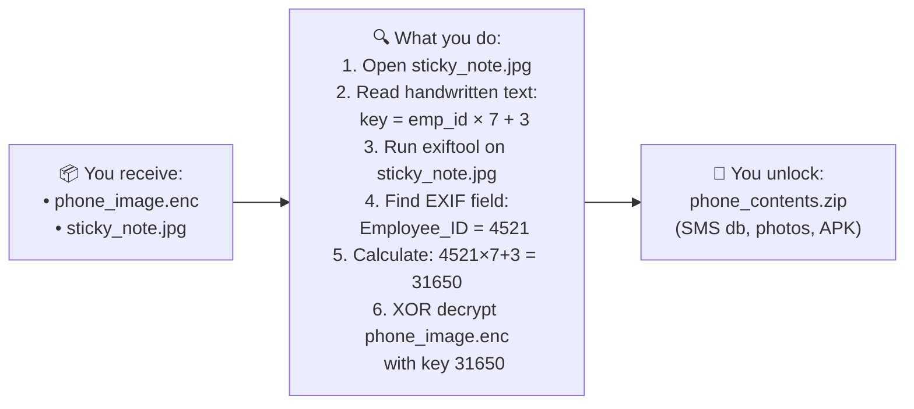

**Flag:** `CID{ph0n3_unlocked_31650}` (submitted to scoreboard to confirm you cracked it)

**How it connects to 1.2:** The ZIP you just decrypted contains the files for the next 3 challenges.

---

### Challenge 1.2 — Deleted Texts 🧪

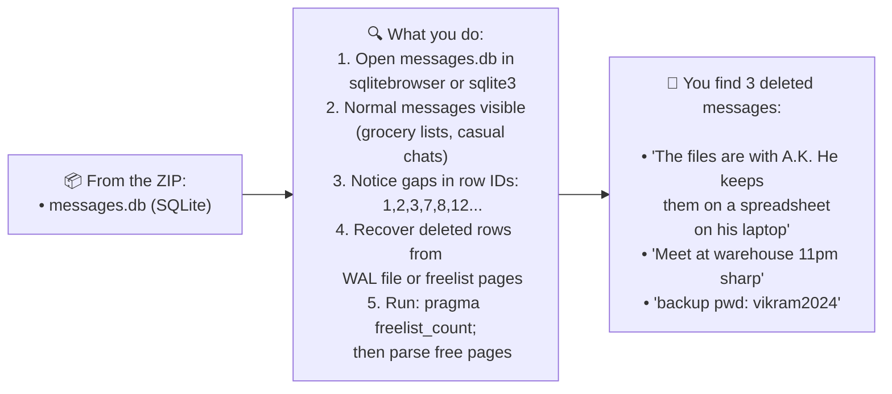

**Flag:** `CID{d3l3t3d_but_n0t_g0n3}`

**How it connects to 1.3:** The password `vikram2024` from deleted texts is needed in the next challenge.

---

### Challenge 1.3 — The Hidden Photo 🖼️

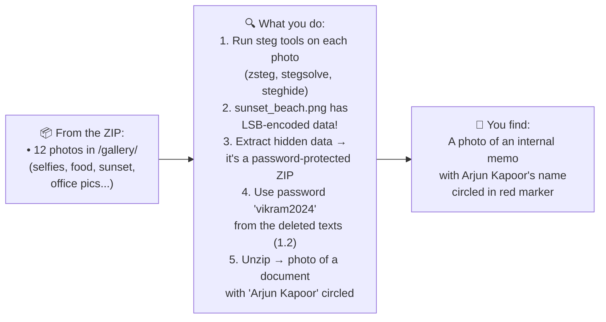

**Flag:** `CID{h1dd3n_1n_pl41n_s1ght}`

**How it connects to 1.4:** You now know Arjun is suspicious, but you need proof. The APK in the ZIP is the last piece.

---

### Challenge 1.4 — The Burner App 🔄

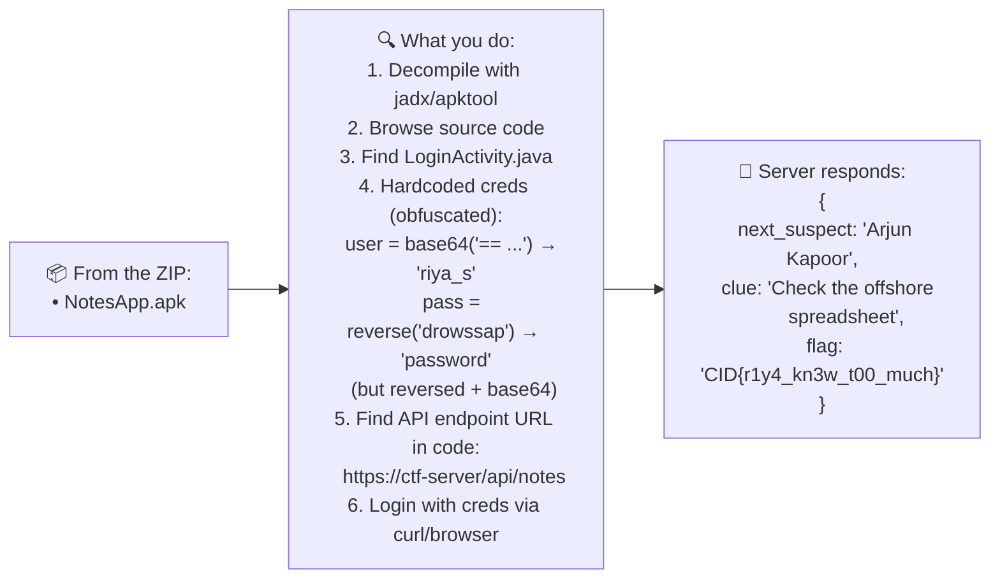

**Flag:** `CID{r1y4_kn3w_t00_much}`

---

### 🔗 CHAIN LINK: Suspect 1 → Suspect 2

> The API response explicitly says: **"Arjun Kapoor"** and **"offshore spreadsheet"**
> The scoreboard unlocks Suspect 2's challenge files after you submit this flag.

---
---

## 👨 SUSPECT 2: Arjun Kapoor — The Business Partner

> Participants are told: *"Arjun Kapoor was Vikram's 50-50 business partner. ₹47 Crore has gone missing from the company. CID seized his laptop — here's what we found."*

---

### Challenge 2.1 — Cooked Books 📊

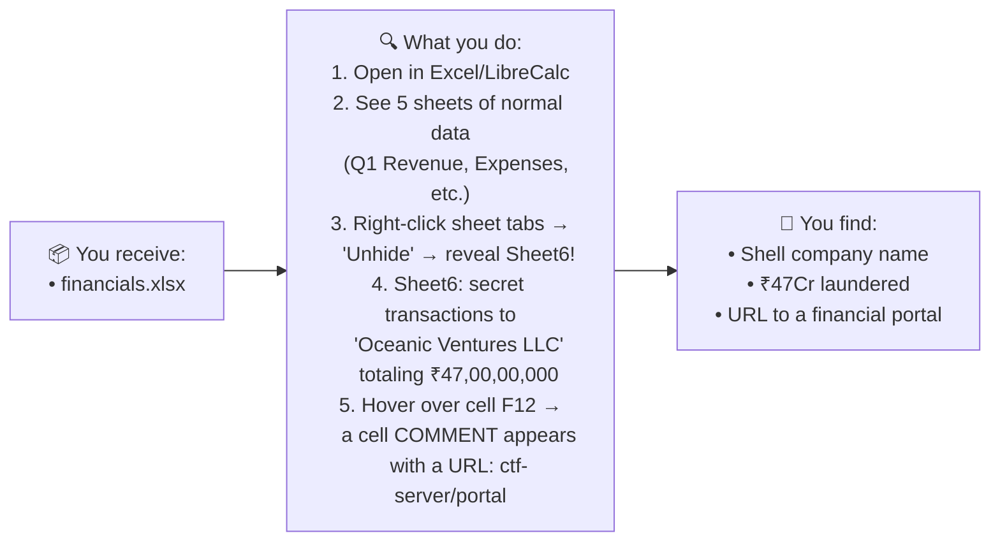

**Flag:** `CID{c00k3d_b00ks_47cr}`

**How it connects to 2.2:** You now have the URL and know about the shell company. The email archive has more details.

---

### Challenge 2.2 — The PGP Puzzle 🔐

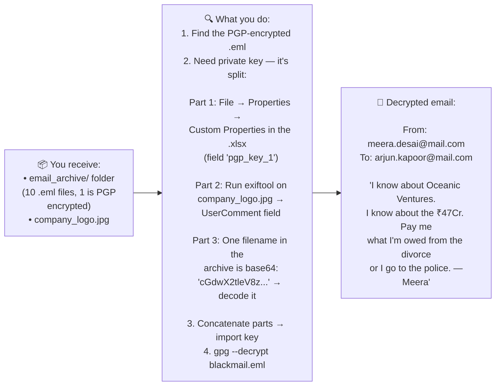

**Flag:** `CID{pgp_p1ec3s_t0g3th3r}`

**How it connects to 2.3:** The blackmail email reveals Meera Desai is involved. The portal URL from 2.1 is the next target.

---

### Challenge 2.3 — Follow the Money 🌐

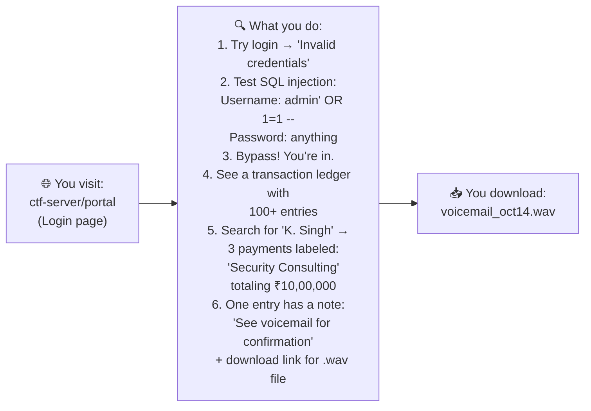

**Flag:** `CID{sql1_th3_b00ks}`

**How it connects to 2.4:** You now have the voicemail file AND you know Karan Singh ("K. Singh") was being paid. But first, decode the voicemail.

---

### Challenge 2.4 — The Voicemail 🔊

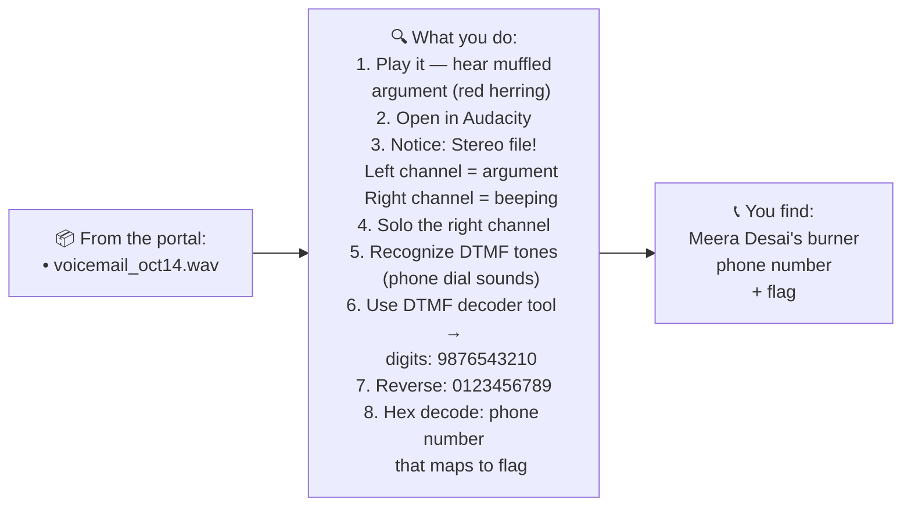

**Flag:** `CID{f0ll0w_th3_m0n3y_tr41l}`

---

### 🔗 CHAIN LINK: Suspect 2 → Suspect 3

> The blackmail email (2.2) names **Meera Desai**. The DTMF phone number is her burner.
> Scoreboard unlocks Suspect 3.

---
---

## 👩 SUSPECT 3: Meera Desai — The Ex-Wife

> *"The divorce left Meera with nothing. Vikram's legal team destroyed her. CID seized her personal laptop."*

---

### Challenge 3.1 — Browser Breadcrumbs 🧪

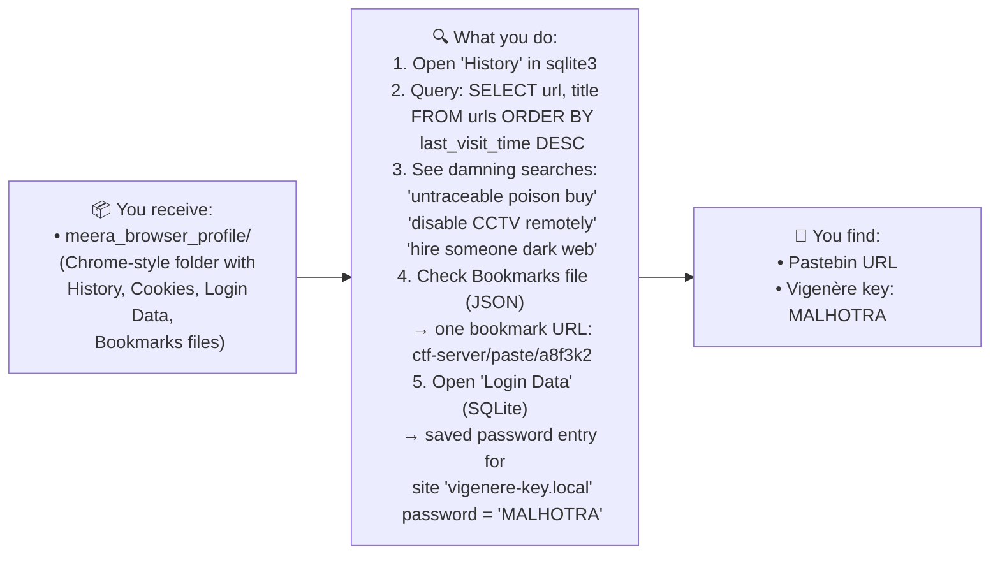

**Flag:** `CID{br0ws3r_n3v3r_f0rg3ts}`

**How it connects to 3.2:** You have the pastebin URL AND the decryption key.

---

### Challenge 3.2 — The Cipher Paste 🔐

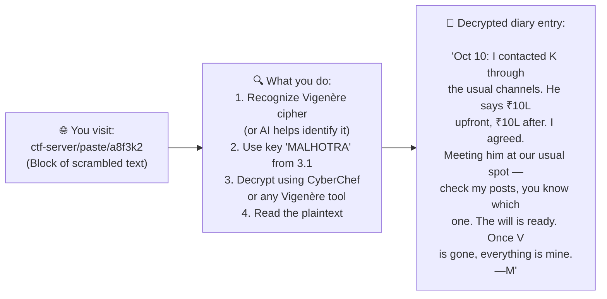

**Flag:** `CID{v1g3n3r3_d14ry_cr4ck3d}`

**How it connects to 3.3:** The diary mentions "the will is ready" → look for the forged will. It also mentions "check my posts" → needed for 3.4.

---

### Challenge 3.3 — The Forged Will 🧪

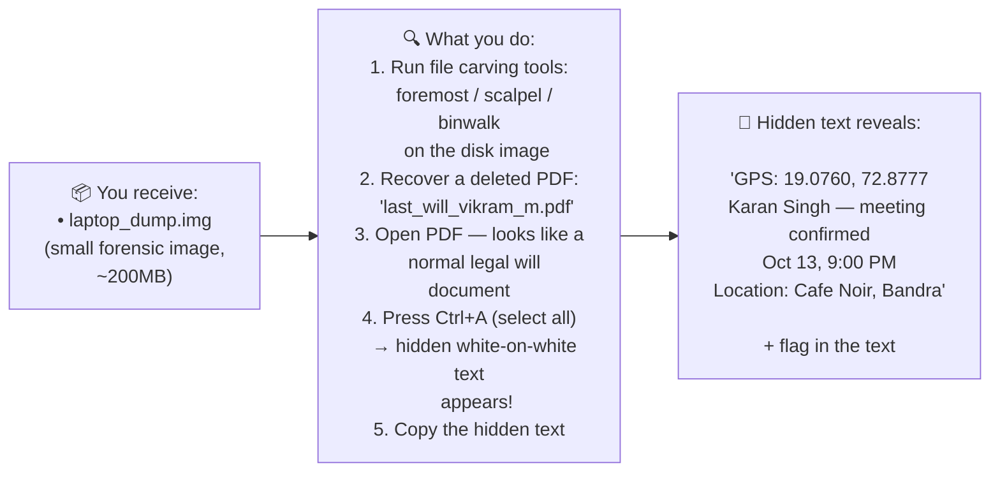

**Flag:** `CID{wh1t3_0n_wh1t3_w1ll}`

**How it connects to 3.4:** You have GPS coordinates. The diary said "check my posts" — time to find Meera's social media.

---

### Challenge 3.4 — The Social Trail 🌐

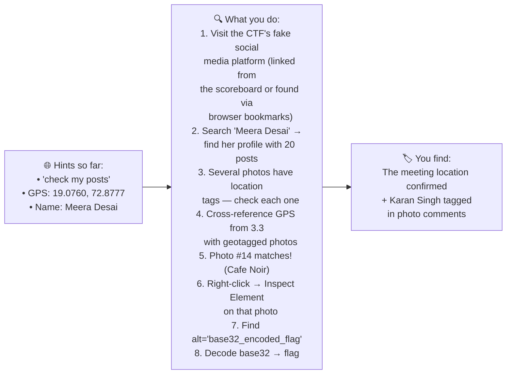

**Flag:** `CID{h3ll_h4th_n0_fury}`

---

### 🔗 CHAIN LINK: Suspect 3 → Suspect 4

> GPS + diary + social media all point to **Karan Singh** as the hired muscle.
> Scoreboard unlocks Suspect 4.

---
---

## 🧔 SUSPECT 4: Karan Singh — The Bodyguard

> *"Vikram's personal bodyguard for 15 years. He had the keys, the codes, and access to everything. CID intercepted his network traffic on the night of the murder."*

---

### Challenge 4.1 — DNS Exfil 🌐

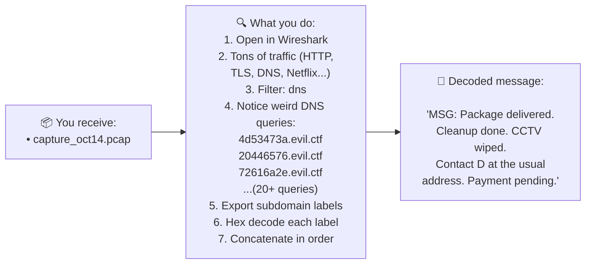

**Flag:** `CID{dns_3xf1l_d3c0d3d}`

**How it connects to 4.2:** "CCTV wiped" — but was it really? Let's check the footage.

---

### Challenge 4.2 — The Tampered Footage 🖼️

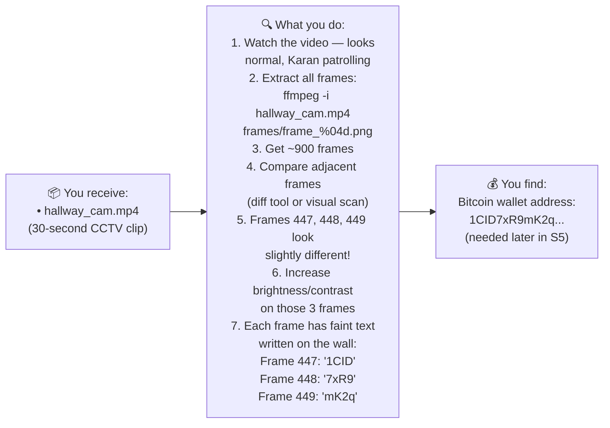

**Flag:** `CID{fr4m3_by_fr4m3}`

**How it connects to 4.3:** Now you know there's crypto payments involved. The radio transmissions will reveal who Karan was coordinating with.

---

### Challenge 4.3 — XOR Radio 🔐

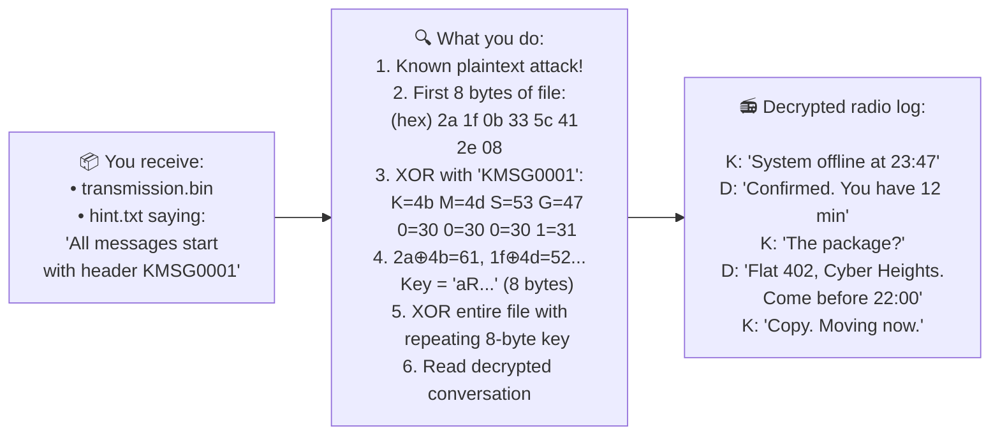

**Flag:** `CID{x0r_kn0wn_pl41nt3xt}`

**How it connects to 4.4:** "D" at "Flat 402, Cyber Heights" — who lives there? The tracker binary will confirm.

---

### Challenge 4.4 — The Tracker Binary 🔄

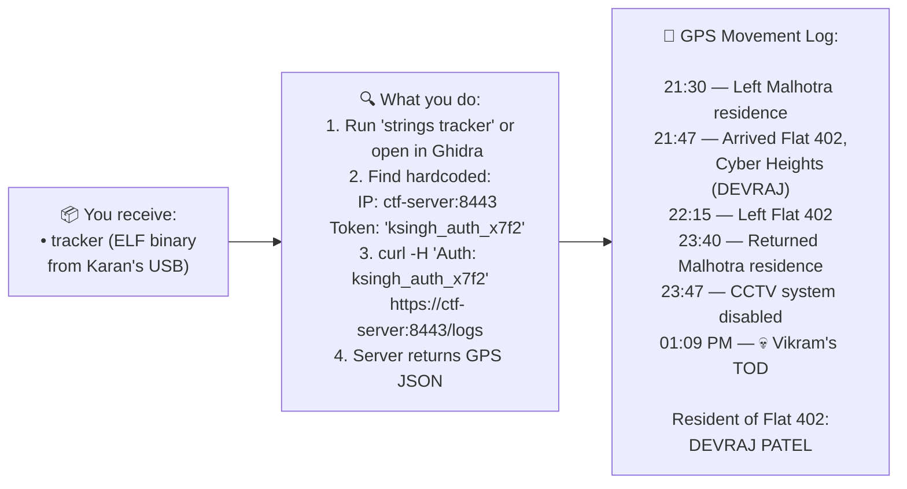

**Flag:** `CID{b0dygu4rd_g0n3_r0gu3}`

---

### 🔗 CHAIN LINK: Suspect 4 → Suspect 5

> GPS logs prove Karan visited **Devraj Patel** 2 hours before the murder. "D" in the radio = Devraj.
> Scoreboard unlocks Suspect 5.

---
---

# 💀💀💀 DIFFICULTY SPIKE 💀💀💀

> From here on, challenges have **multiple layers**, **deliberate misdirections**, and require **real exploitation skills**. AI can help write scripts but cannot replace hands-on work.

---

## 👨‍💻 SUSPECT 5: Devraj Patel — The Hacker

> *"A digital ghost. No social media, no public records. But every system Vikram owned has his fingerprints on it."*

---

### Challenge 5.1 — The Server 💻

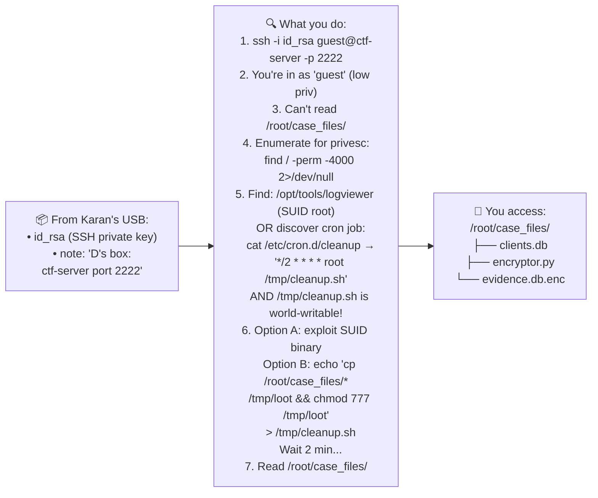

**Flag:** `CID{r00t3d_th3_gh0st}` (found in `/root/flag.txt`)

**How it connects to 5.2:** You now have the ransomware script AND the encrypted database.

---

### Challenge 5.2 — The Ransomware 🔄

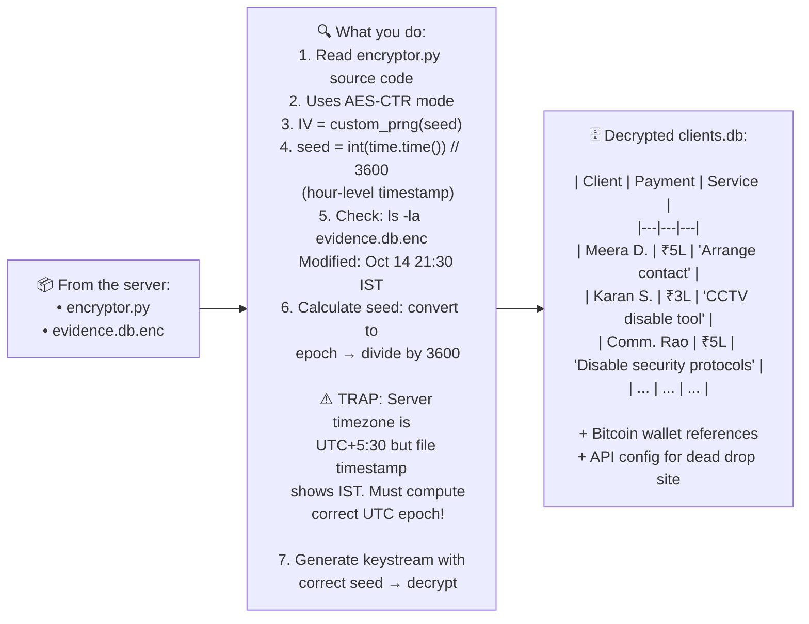

**Flag:** `CID{t1m3z0n3_tr4p_f3ll}`

**How it connects to 5.3:** The Bitcoin wallet from S4C2 appears in the DB. Time to follow the money.

---

### Challenge 5.3 — Blockchain Trace 🔐🌐

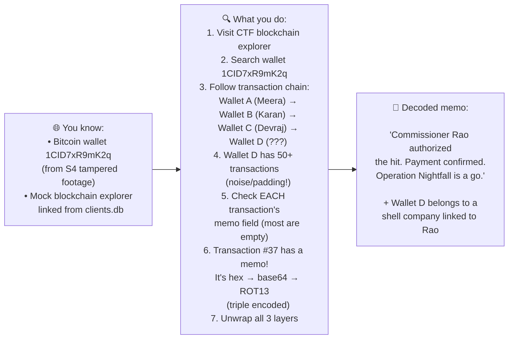

**Flag:** `CID{bl0ckch41n_n3v3r_l13s}`

**How it connects to 5.4:** You now have proof Rao is involved. One more piece — the dead drop file.

---

### Challenge 5.4 — The Dead Drop 🌐

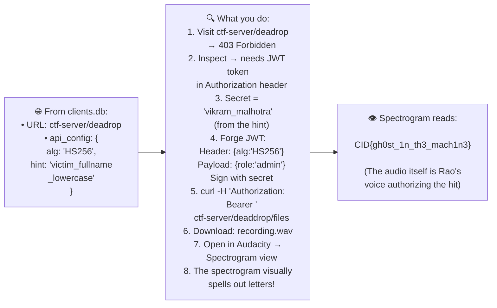

**Flag:** `CID{gh0st_1n_th3_mach1n3}`

---

### 🔗 CHAIN LINK: Suspect 5 → Suspect 6

> Client list, blockchain, AND audio recording all point to **Commissioner Rao**.
> To unlock Suspect 6: **submit all 5 previous flags**.

---
---

## 👴 SUSPECT 6: Commissioner Rao — The Insider (FINAL BOSS)

> *"He assigned himself to lead the investigation. He was suppressing evidence, misdirecting officers, and covering tracks. The man solving the case... was the one who ordered the murder."*

### 🔒 Entry Gate

```
Combine all 5 suspect flags:
CID{r1y4_kn3w_t00_much}
CID{f0ll0w_th3_m0n3y_tr41l}
CID{h3ll_h4th_n0_fury}
CID{b0dygu4rd_g0n3_r0gu3}
CID{gh0st_1n_th3_mach1n3}

Concatenate → this is the passphrase for the final archive
```

---

### Challenge 6.1 — The Vault 🔐

```mermaid
flowchart LR
    A["📦 You receive:\n• rao_vault.7z\n  (password = concatenated\n   5 flags)"] --> B["🔍 What you do:\n1. 7z x rao_vault.7z -p'CID{r1y4\n   _kn3w_t00_much}CID{f0ll0w...}'\n2. Inside: multiple files\n   including confession_draft.enc\n3. It's XOR encrypted again\n4. Derive the OTP key:\n   Take content between {}\n   of each flag → first char:\n   r, f, h, b, g = 'rfhbg'\n5. XOR confession_draft.enc\n   with repeating key 'rfhbg'\n6. Decrypt → read confession"]
    B --> C["📝 Rao's confession draft:\n\n'I did what had to be done.\nVikram was going to expose the\nentire network. Arjun funded it,\nMeera wanted revenge, I wanted\nprotection. Devraj handled the\ntechnical side. Karan did the\nrest. ₹2Cr was my price.\nFlight to Caracas booked for\nOct 20. — R'"]
```

**Flag:** `CID{th3_c0nf3ss10n}`

---

### Challenge 6.2 — The Mole Network 🌐

```mermaid
flowchart LR
    A["🌐 From Rao's files:\n• URL to CID internal portal\n  ctf-server/cid-portal"] --> B["🔍 What you do:\n1. Register an account on portal\n2. Login → your profile page:\n   /profile?id=1337\n3. Try IDOR: /profile?id=1\n   → Commissioner Rao's profile!\n4. See 'Documents' tab\n5. Click download on\n   'operation_nightfall.pdf'\n   → Error: invalid token\n6. View page source →\n   find hidden form field\n   with TOTP token logic\n7. Read the JavaScript:\n   secret is in the JS source\n8. Generate valid TOTP token\n9. Submit form → download PDF"]
    B --> C["📋 operation_nightfall.pdf:\n\nFull murder plan:\n• Oct 13 21:00 — Karan meets Devraj\n• Oct 14 12:47 PM — CCTV kill switch\n• Oct 14 01:00 PM — Karan enters penthouse\n• Oct 14 01:09 PM — Vikram eliminated\n• Oct 14 01:25 PM — USB drive extracted\n• Payments: Meera ₹20L, Karan ₹20L,\n  Devraj ₹8L, Rao ₹2Cr"]
```

**Flag:** `CID{m0l3_n3tw0rk_3xp0s3d}`

---

### Challenge 6.3 — The Escape Plan 🧪

```mermaid
flowchart LR
    A["📦 From the vault:\n• boarding_pass.pdf\n  (Flight to Caracas,\n   Oct 20)"] --> B["🔍 What you do:\n1. Run pdfid / pdf-parser\n   on the PDF\n2. Detect: /JavaScript action!\n   (suspicious for a boarding pass)\n3. Extract embedded JS\n4. JS is obfuscated:\n   var a='C';var b='H';\n   var c=a+b+...(100 lines)\n5. Deobfuscate (manually or\n   use JS beautifier + eval)\n   → reveals IBAN number:\n   CH93 0076 2011 6238 5295 7\n6. ALSO: scan the PDF417\n   barcode on the boarding pass\n   using a barcode reader\n7. Barcode data ≠ visible text!\n   Passenger: 'Rajesh Verma'\n   (Rao's alias!)"]
    B --> C["🛫 You find:\n• Swiss bank IBAN\n• Rao's escape alias:\n  'Rajesh Verma'\n• Flag components from\n  both the JS + barcode"]
```

**Flag:** `CID{n0_3sc4p3_fr0m_just1c3}`

---

### Challenge 6.4 — Case Closed 🏆

```mermaid
flowchart LR
    A["📦 You receive:\n• memory_dump.raw\n  (~100MB, from Rao's\n   office computer)"] --> B["🔍 What you do:\n1. Load in Volatility 3:\n   vol -f memory_dump.raw\n   windows.pslist\n2. Find suspicious process:\n   'evidence_shredder.exe'\n   PID: 4892\n3. Dump process memory:\n   vol -f memory_dump.raw\n   windows.memmap --pid 4892\n   --dump\n4. Strings on the dump →\n   find AES key in plaintext:\n   'NIGHTFALL_KEY_2024'\n5. Also find filename:\n   'final_confession.mp4.enc'\n6. Encrypted video is in\n   Rao's vault files\n7. openssl aes-256-cbc -d\n   -k 'NIGHTFALL_KEY_2024'\n   -in final_confession.mp4.enc\n   -out final_confession.mp4\n8. Play video: Rao typing\n   his confession on screen\n9. exiftool final_confession.mp4\n   → Comment field = flag"]
    B --> C["🏆 MASTER FLAG:\n\nCID{c4s3_cl0s3d_just1c3_s3rv3d}\n\n🎉 CASE SOLVED 🎉\n\nThe conspiracy:\nMeera wanted revenge.\nArjun wanted the money.\nRao wanted protection.\nDevraj was the tech.\nKaran was the muscle.\nRiya knew too much."]
```

**Flag:** `CID{c4s3_cl0s3d_just1c3_s3rv3d}`

---

## 📊 Complete Flag Table

| # | Challenge | Flag | Points |
|---|-----------|------|--------|
| 1.1 | Crack the Phone | `CID{ph0n3_unlocked_31650}` | 100 |
| 1.2 | Deleted Texts | `CID{d3l3t3d_but_n0t_g0n3}` | 100 |
| 1.3 | Hidden Photo | `CID{h1dd3n_1n_pl41n_s1ght}` | 100 |
| 1.4 | Burner App | `CID{r1y4_kn3w_t00_much}` | 100 |
| 2.1 | Cooked Books | `CID{c00k3d_b00ks_47cr}` | 125 |
| 2.2 | PGP Puzzle | `CID{pgp_p1ec3s_t0g3th3r}` | 125 |
| 2.3 | Follow the Money | `CID{sql1_th3_b00ks}` | 125 |
| 2.4 | Voicemail | `CID{f0ll0w_th3_m0n3y_tr41l}` | 125 |
| 3.1 | Browser Breadcrumbs | `CID{br0ws3r_n3v3r_f0rg3ts}` | 150 |
| 3.2 | Cipher Paste | `CID{v1g3n3r3_d14ry_cr4ck3d}` | 150 |
| 3.3 | Forged Will | `CID{wh1t3_0n_wh1t3_w1ll}` | 150 |
| 3.4 | Social Trail | `CID{h3ll_h4th_n0_fury}` | 150 |
| 4.1 | DNS Exfil | `CID{dns_3xf1l_d3c0d3d}` | 175 |
| 4.2 | Tampered Footage | `CID{fr4m3_by_fr4m3}` | 175 |
| 4.3 | XOR Radio | `CID{x0r_kn0wn_pl41nt3xt}` | 175 |
| 4.4 | Tracker Binary | `CID{b0dygu4rd_g0n3_r0gu3}` | 175 |
| 5.1 | The Server | `CID{r00t3d_th3_gh0st}` | 250 |
| 5.2 | Ransomware | `CID{t1m3z0n3_tr4p_f3ll}` | 250 |
| 5.3 | Blockchain Trace | `CID{bl0ckch41n_n3v3r_l13s}` | 250 |
| 5.4 | Dead Drop | `CID{gh0st_1n_th3_mach1n3}` | 250 |
| 6.1 | The Vault | `CID{th3_c0nf3ss10n}` | 300 |
| 6.2 | Mole Network | `CID{m0l3_n3tw0rk_3xp0s3d}` | 300 |
| 6.3 | Escape Plan | `CID{n0_3sc4p3_fr0m_just1c3}` | 300 |
| 6.4 | Case Closed | `CID{c4s3_cl0s3d_just1c3_s3rv3d}` | 300 |
| | | **TOTAL** | **4,500** |
